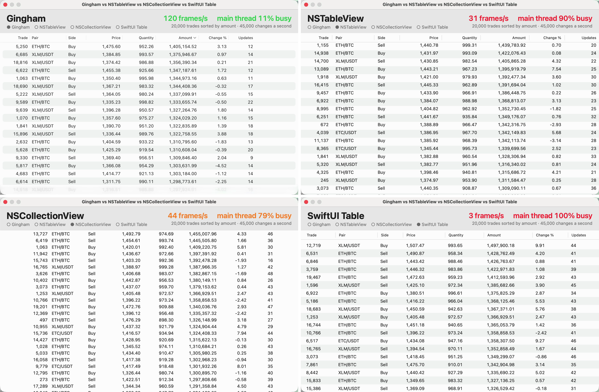

<h1 align="center">
  <picture>
    <source media="(prefers-color-scheme: dark)" srcset="https://raw.githubusercontent.com/digitalglobeby/Gingham/main/Assets/logo-dark.svg">
    
  </picture>
</h1>

<p align="center">
  
  
  
</p>

**On a MacBook Pro (M1 Max, 120 Hz), Gingham presents 119 frames a second of
a million live rows taking 300,000 row changes a second** (107 counted from
the screen) in a 2040 × 1080-point table; the fastest NSTableView we could
write updates at most 40 times a second, a typical one 4.

<!-- The new video goes here, on a line of its own: upload gingham-comparison-2026-11-23.mp4 (26 s: Gingham, NSTableView, NSTableView cell-based, SwiftUI Table) in GitHub's web editor and paste its URL. -->



Live trades in Gingham, in NSTableView as apps typically write it, in
NSTableView's cell-based mode tuned by hand (the fastest AppKit table we
measured) and in SwiftUI's Table: 20,000 rows sorted by amount, about 44,800
row changes a second, in the bench's default window. Four moments of four
runs, recorded on the screen: the numbers in the windows were measured live
meanwhile and differ from the quiet runs' (Gingham's main thread read 25%
busy there, 48% in the quiet runs); the tables below are the quiet runs'
medians.

## Benchmarks

The same live data in Gingham and in Apple's tables, measured the same way
for each by an open benchmark, [Gingham Bench](https://github.com/digitalglobeby/gingham-bench)
(MIT): the code of every table, the data and [how it's measured](https://github.com/digitalglobeby/gingham-bench#how-its-measured).
Gingham is used through its public API (a data source, `sortsRows`, targeted
reloads). Its competitors on the Mac:

- **NSTableView** as apps typically write it: view-based, and the app sorts
  all the rows again after each batch of changes and reloads the rows in
  view.
- **NSTableView, tuned** as an AppKit expert would: changed cells updated in
  place, an incremental sort.
- **NSTableView, cell-based**: its older cell-based mode, tuned the same way.
- **NSCollectionView**, tuned the same way.
- **SwiftUI Table**, as documented and tuned.

If you can make one of them faster, open a pull request there: it will be
measured.

### Mac: live data, the default window (1000 × 640 points of table)

Screen updates a second (the table's pixels, captured from outside every
table) · main thread busy (less leaves more room for your app).

| Table | Live trades: 20,000 rows, ~44,800 changes/s | Order book: 200,000 rows, ~243,500 changes/s | Trade feed: 1,000,000 rows, ~300,000 changes/s |
| --- | --- | --- | --- |
| **Gingham** | **73** · 48% | **111** · 55% | **110** · 37% |
| NSTableView | 42 · 96% | 19 · 99% | 10 · 99% |
| NSTableView, tuned | — ¹ · 65% | 52 · 98% | 42 · 98% |
| NSTableView, cell-based | 58 · 48% | 94 · 84% | 96 · 83% |
| NSCollectionView | 52 · 65% | 52 · 98% | 42 · 98% |
| SwiftUI Table | 0 · 100% | stuck ² | stuck ² |
| SwiftUI Table, tuned | 4 · 100% | stuck ² | stuck ² |

In this window the cell-based NSTableView comes closest: 58, 94 and 96
screen updates a second to Gingham's 73, 111 and 110, with its main thread
48–84% busy to Gingham's 37–55%. The screen capture tops out near 110 frames
a second (on the order book it counted 110.6 of the 119.4 frames Gingham
presented; a system trace confirmed Gingham's presented frames). Live trades
are sorted by amount, and not every batch of changes reaches the rows in
view, so no table can show 120 updates a second there; Gingham and the
cell-based NSTableView applied new changes at nearly every refresh (118 and
119 times a second).

¹ The screen run was invalid (the window was covered); its measured runs
applied 101 updates a second, and its traced run read 50 screen updates a
second. ² The main thread didn't come back within 15 s after the measured
window.

### Mac: live data, a large window (2040 × 1080 points of table)

The frames Gingham presented (exact: Gingham reports each one) or, for the
others, the updates applied a second (the most they can have shown), with
the screen updates counted from the screen in parentheses (the capture tops
out near 110) · main thread busy.

| Table | Live trades | Order book | Trade feed |
| --- | --- | --- | --- |
| **Gingham** | **120** (92) · 38% | **120** (108) · 35% | **119** (107) · 73% |
| NSTableView | 27 (26) · 96% | 10 (9) · 99% | 4 (4) · 99% |
| NSTableView, tuned | 47 (39) · 93% | 31 (30) · 97% | 14 (14) · 96% |
| NSTableView, cell-based | 114 (68) · 75% | 76 (71) · 97% | 40 (40) · 96% |
| NSCollectionView | 48 (41) · 93% | 32 (30) · 97% | 15 (14) · 98% |
| SwiftUI Table | stuck ² | stuck ² | stuck ² |
| SwiftUI Table, tuned | 2 (2) · 100% | stuck ² | 0 (0) · 100% |

With more cells in view, Apple's tables fall further behind. Gingham's main
thread is busier on the trade feed at this size (73%, against 37% in the
default window), and it still presents a frame at nearly every refresh.

On [Binance's live tickers](https://github.com/digitalglobeby/gingham-bench/blob/main/results/2026-11-23-1146.md#binance-tickers)
(about 3,100 pairs, a live market, so the numbers vary), the cell-based
NSTableView and NSCollectionView show slightly more screen updates than
Gingham (43 and 44 a second to its 39), and Gingham's main thread is the
least busy (19%, to their 36–43%; the typical NSTableView's and SwiftUI
Table's 94%).

### Mac: sorting 1,000,000 rows by a text column

A header click on a table of 1,000,000 rows, sorted in Finder's order
(`localizedStandardCompare`): time until the sorted order is on the screen ·
the longest the screen waited meanwhile.

| Table | By pair: about 500 distinct texts | By account: nearly every row a different text |
| --- | --- | --- |
| **Gingham** | 0.15 s · 16 ms | **0.18 s** · 14 ms |
| NSTableView | 5.18 s · 5,183 ms | 7.99 s · 7,993 ms |
| NSTableView, tuned | 0.16 s · 77 ms | 7.85 s · 79 ms |
| NSTableView, cell-based | **0.09 s** · 8 ms | 7.83 s · 17 ms |
| NSCollectionView | 0.11 s · 8 ms | 7.81 s · 35 ms |
| SwiftUI Table | not sorted within 60 s | not sorted within 60 s |
| SwiftUI Table, tuned | 0.92 s · 797 ms | 13.29 s · 890 ms |

The tuned AppKit tables compare each distinct text once and sort in the
background. With 500 texts that's quick, and the cell-based NSTableView sorts
by pair faster than Gingham (0.09 s to 0.15 s); with nearly a million it
takes them about 8 seconds, Gingham 0.18 s. The typical NSTableView sorts on
the main thread, and the app stops meanwhile.

### iPhone: scrolling while values change

UITableView and UICollectionView as typically written (changed rows
reconfigured, as Apple recommends) and tuned (changed values set on the cells
in view), and SwiftUI's List, with 100,000 rows and 1,000 changes a second.
What the render server showed: XCUITest's real flicks (UIKit's own scroll
metric, the median of five flicks) and Instruments' Animation Hitches during
the app's scroll tests (one run of each table's three tests).

| Table | Real flicks: frames a second · hitches | Animation Hitches: hitch time a second |
| --- | --- | --- |
| **Gingham** | 117.6 · 0 | 1.6–8.3 ms |
| UITableView | 111.1 · 294 (72.5 ms a second) | 503–507 ms |
| UITableView, tuned | 119.0 · 0 | 1.0–3.6 ms |
| UICollectionView | 116.0 · 0 | 0–2.1 ms |
| UICollectionView, tuned | 118.7 · 0 | 0–9.9 ms |
| SwiftUI List | 117.3 · 0 | 3.1–5.2 ms |

The app's own meter (its main thread's frame callbacks, which don't see the
render server's work), scrolling a flick a second, four down and four up,
while values change (the bench's `flicks` test, median of 3 runs): frames a
second · main thread busy.

| Table | 100,000 rows, 1,000 changes/s | 1,000,000 rows, 10,000 changes/s |
| --- | --- | --- |
| **Gingham** | 120 · **20%** | 120 · **31%** |
| UITableView | 62.4 · 82% | 6.3 · 98% |
| UITableView, tuned | 120 · 36% | 120 · 40% |
| UICollectionView | 120 · 43% | 120 · 40% |
| UICollectionView, tuned | 120 · 40% | 120 · 41% |
| SwiftUI List | 119.7 · 40% | 120 · 48% |

On the iPhone, well-written UIKit tables and SwiftUI's List keep up too;
Gingham does it with its main thread less busy (20% and 31% to their
36–48%), and the typical UITableView falls behind, to 6 frames a second with
a million rows on the app's meter. SwiftUI's Table shows only its first
column on the iPhone and isn't compared there.

Measured on 2026-11-23 on a MacBook Pro (M1 Max, 32 GB), macOS 27.2.1, its
built-in 120 Hz display, and an iPhone 15 Pro Max, iOS 27.2.1; Gingham 1.1.1,
Release builds, medians of 3 runs. Every column of every run, with the lowest
and highest, is in the bench's [results](https://github.com/digitalglobeby/gingham-bench/tree/main/results);
how each table is set up and measured, in its [README](https://github.com/digitalglobeby/gingham-bench#how-its-measured).

## Features

A table view for business data on the Mac, iPad and iPhone, drawn by the
GPU, with an API that mirrors `NSTableView`, so apps migrate without
reworking their patterns. One `GHTableView` class works in AppKit and in
UIKit, with the same data source, delegate and features; on the iPad and
iPhone it takes touches, the pointer, a hardware keyboard and VoiceOver as
the system's own controls do.

- **Frozen columns** at the leading and trailing edges, and **column groups**
  under a common header.
- **Summary row**: sums, averages, counts, minimums and maximums, value filters
  and **formulas** over other columns (e.g. ROI as a ratio of sums), for all
  rows, the selected rows or all except the selected ones. Large tables are
  summarized in the background.
- **Row grouping** by column values, several levels deep, under collapsible
  header rows with row counts and subtotals.
- **Search and filters** that hide rows without touching the data source.
- **Row identity**: the selection follows the same records when data is sorted
  or refreshed.
- **Live data**: targeted updates (`reloadData(forRowIndexes:columnIndexes:)`,
  inserts, removes, moves, batched with `beginUpdates()`/`endUpdates()`) cost
  what changed; the table keeps the rows sorted itself as values change
  (`sortsRows`), or `reorderRows(from:to:)` re-sorts without reading the rows
  again.
- **Tens of millions of rows** through a column source (`GHColumnSource`):
  the table's sort, search and totals read your data on all cores, off the
  main thread, and keep no values.
- **Text sorts like Finder**, in `localizedStandardCompare`'s order, a million
  texts in about 0.2 seconds in the background, for every European language,
  Cyrillic, Greek, Hebrew, Arabic, Devanagari, kana, Han and Hangul; the
  optional [GinghamICU](GinghamICU.md) library adds ICU's collation for Thai
  and for Chinese texts with many readings.
- **NSTableView's patterns**: the same data source, delegate, sort
  descriptor and notification names, a diffable data source like
  `NSTableViewDiffableDataSource`, and an adapter for an existing
  `NSTableViewDataSource`.
- **Context menus** built by the app, with Finder's rules for which rows a
  click is for.
- **Column customization**: resize, move, hide and show columns, saved and
  restored.
- Values as text, numbers, currencies, percentages, dates, check marks,
  colored **tags**, icon **marks**, **sparklines** (lines, areas, bars, wins and
  losses), **links**, **buttons**, **progress bars**, **ratings**, and
  **pictures and videos** by URL (loaded, cached and played under the pointer
  by the table); text that **wraps**, rows as high as it.
- Native feel: overlay scrollers, elastic scrolling, Liquid Glass summary bar
  on macOS 26, dark mode, accent colors, keyboard navigation, type select,
  copying to spreadsheets, VoiceOver.
- **On the iPad and iPhone**: momentum scrolling, taps that select and act like clicks,
  editing in place, context menus on a long press, swipe actions, columns
  resized and moved by a finger, filters and choices in popovers, drag and
  drop, export to the share sheet, the pointer's hover, a hardware keyboard,
  VoiceOver's data table, and the summary row above the home indicator.

Your app owns the data. The table sorts the rows itself (`sortsRows`, in the
background for large tables) or leaves sorting to your app like
`NSTableView`, and your app performs the actions of its buttons and menus.

In SwiftUI on the Mac, `GHDataTable` works like `Table` (on the iPad it
comes next; until then wrap `GHTableView` in a `UIViewRepresentable`):

```swift
GHDataTable(campaigns, selection: $selection) {
    GHDataColumn("Name", value: \.name)
    GHDataColumn("Spend", value: \.spend, format: .currency(code: "USD"), summary: .aggregate(.sum))
}
```

## Requirements

- A Mac with macOS 14 or later, Apple silicon only, like macOS 27 (the
  frameworks are arm64); Liquid Glass on macOS 26 and later
- iOS and iPadOS 17 or later (the table view in UIKit, on the iPad and the
  iPhone)
- Swift 6.2 or later (Xcode 26 or later)
- On the iOS simulator, the frameworks are arm64 only (Apple silicon): builds
  for Any iOS Simulator Device need x86_64 excluded
  (`EXCLUDED_ARCHS[sdk=iphonesimulator*] = x86_64`)

## Installation

In Xcode, choose **File > Add Package Dependencies**, enter the repository's
URL, and add the `Gingham` library to your app target. In a `Package.swift`:

```swift
dependencies: [
    .package(url: "https://github.com/digitalglobeby/Gingham", from: "1.1.1"),
],
targets: [
    .target(name: "MyApp", dependencies: ["Gingham"]),
]
```

For ICU's collation keys (Thai, Chinese text with many words read otherwise,
or ICU's own order), also add the optional `GinghamICU` library, `.product(name: "GinghamICU", package: "Gingham")` (about 9 MB per
architecture, see [GinghamICU](GinghamICU.md)). Apps without it don't build its ICU.

### Versions

Gingham follows semantic versioning, with one rule for enums: a minor
version may add cases to the public enums that describe values, formats,
filters and summaries (`GHValueFormat`, `GHColumnFilter`, `GHCellValue`,
`GHAggregate` and the like), such as a new kind of filter or format. Keep a
`default` in a `switch` over them, and updates won't stop your code from
compiling. Only `GHColumnItem`,
`GHDataColumnItem`, `GHColumnPin` and `GHColumnVisibility.State` keep their
cases until the next major version.

> [!TIP]
> Gingham is a binary framework built with library evolution: its enums may
> get new cases, so a `switch` over one needs `@unknown default`.
> `GHColumnItem`, `GHDataColumnItem`, `GHColumnPin` and
> `GHColumnVisibility.State` are `@frozen` and switch without it. So are
> `GHCellValue` and `GHNamedColor` (since 1.0.1, so that an app makes values
> as fast as Gingham does), but they may still get new cases in a minor
> version: keep a `default`.

## Quick start

```swift
import AppKit
import Gingham

struct Campaign {
    var id: String
    var name: String
    var spend: Double
}

@MainActor
final class CampaignTableData: GHTableViewDataSource {
    var campaigns: [Campaign] = []

    func numberOfRows(in tableView: GHTableView) -> Int {
        campaigns.count
    }

    func tableView(_ tableView: GHTableView, valueFor column: GHTableColumn, row: Int) -> GHCellValue {
        let campaign = campaigns[row]
        switch column.id {
        case "id": return .text(campaign.id)
        case "name": return .text(campaign.name)
        case "spend": return .number(campaign.spend)
        default: return .empty
        }
    }
}

final class CampaignsViewController: NSViewController {
    private let data = CampaignTableData()
    private let table = GHTableView(frame: .zero)

    override func loadView() {
        table.columns = [
            .column(GHTableColumn("name", title: "Campaign", width: 240, pin: .leading)),
            .column(GHTableColumn("spend", title: "Spend", width: 120, alignment: .automatic,
                                  format: .currency(code: "EUR"), summary: .aggregate(.sum))),
        ]
        table.rowIdentifierColumnID = "id"   // The selection follows the same campaigns.
        table.autosaveName = "Campaigns"     // The user's columns are remembered.
        table.dataSource = data
        view = table
    }

    func show(_ campaigns: [Campaign]) {
        data.campaigns = campaigns
        table.reloadData()                   // Always right after changing the data.
    }
}
```

On the iPad the same data source makes the table; put it in a
`UIViewController` (`view = table`, or as a subview pinned to the edges:
it keeps its summary row above the home indicator by itself). What the Mac
does with the mouse the iPad does by touch:

| On the Mac | On the iPad |
| --- | --- |
| Click, Command- and Shift-click | Tap (Command and Shift with a hardware keyboard) |
| Double click | Double tap (edits an editable cell) |
| Right-click menu: `tableView(_:menuForRows:clickedRow:column:)` returns an `NSMenu` | Long press: the same method returns a `UIMenu` |
| Trackpad swipe across a row | Finger swipe (where the table can't scroll further sideways) |
| Dragging a column's edge or title | The same, by a finger |
| Filter button, Option-Down Arrow | The header menu's Filter item, the filter button of a filtered column |
| `pasteboardWriterForRow`, `validateDrop`, `acceptDrop` | `itemsForBeginning`, `dropSessionDidUpdate`, `performDrop` (like `UITableView`'s) |
| `exportDocument(_:)`: a save panel | `exportDocument(_:)`: the share sheet |

## Rules that matter

1. Call `reloadData()` **immediately** after changing the data, before
   selecting, scrolling or returning to the run loop. Until then the table
   still asks about the old rows.
2. Row indexes in the API (selection, `clickedRow`, data source and delegate
   calls) are **data source indexes**, also while a filter hides rows. They are
   only valid until the next reload: keep record ids, not indexes, in menus and
   asynchronous work.
3. Give rows an **identity** (`rowIdentifierColumnID` or
   `tableView(_:identifierForRow:)`), unique per record.
4. The table holds its **data source and delegate weakly**; capture `self`
   weakly in `GHRowFilter.isIncluded`.
5. Keep `tableView(_:valueFor:row:)` a **cheap lookup**, and return static
   color constants for row tints and markers.
6. Don't put the table in an `NSScrollView` or a `UIScrollView`: it scrolls
   by itself.

## License

Gingham is free for any use, commercial too, with up to 10,000 rows a table
(a table with more shows the first 10,000 and a notice). A license key shows
every row: it's per developer and covers a major version (all of 1.x), and
apps shipped with it stay licensed. Register it at launch with
`GHLicense.register(_:)`.

- [Buy a license key](mailto:d.polikhranidi+gingham@gmail.com?subject=Gingham%20license%20key)
- [Get a 30-day trial key](mailto:d.polikhranidi+gingham@gmail.com?subject=Gingham%20trial%20key)

See [LICENSING.md](LICENSING.md) and [LICENSE](LICENSE);
`GHTableView.version` tells which version you have.

## Documentation

The package has full DocC documentation: API reference for every public type
and member, and articles (written for the Mac; on the iPad the API is the
same, and the table above maps the interactions):

| Article | Covers |
| --- | --- |
| Getting Started | Adding the package, columns, data source, showing and reloading |
| Integrating into an App | A complete CRM screen: model, data source, sorting, search, filters, menus, refresh, live updates, column sources for millions of rows, checklist |
| Migrating from NSTableView | The NSTableView → GHTableView mapping, the data source adapter, diffable data sources, what works differently |
| Defining Columns | Options, frozen columns, groups, icon columns, user customization, saving layouts |
| Editing Cells | Cell navigation, editing in place, check boxes and choices, Undo |
| Displaying Values | Value kinds, formats, tags, marks, sparklines, links, buttons, progress bars, ratings, pictures and videos, the pointer over cells |
| Summaries | Aggregates, value filters, formulas, scopes, group subtotals, large tables |
| Filtering and Search | Row filters, search matching, row indexes while filtering, empty states |
| Grouping Rows | Groups by column values, header rows with subtotals, collapsing, order of groups |
| Selection and Sorting | Selection API, row identity, sorting, re-sorting without reloading |
| Menus and Actions | Row context menus, actions, copying |
| Appearance | Sizes, row tints and markers, selection style, scrolling |
| Keyboard and Accessibility | Keyboard commands, type select, VoiceOver |
| Performance and Threading | What the table reads and when, large data, tens of millions of rows, live updates, memory |
| Benchmarks | Gingham against Apple's tables on the Mac and the iPhone: what was measured, the results, the open bench |
| Using Gingham in SwiftUI | `GHDataTable`: columns, selection, sorting, editing, menus (the Mac's) |
| Release Notes | What each version brought |

Read it at **https://digitalglobeby.github.io/Gingham/documentation/gingham**.
Symbol documentation also shows in Xcode's Quick Help (Option-click a symbol).

## Support

Bug reports, questions and ideas are welcome as issues. Gingham ships as a
binary; for a license key, write to **d.polikhranidi+gingham@gmail.com**.
