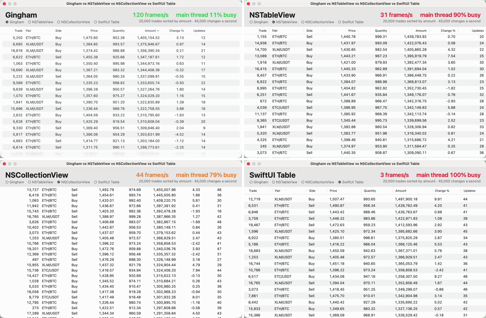

<h1 align="center">
  <picture>
    <source media="(prefers-color-scheme: dark)" srcset="https://raw.githubusercontent.com/digitalglobeby/Gingham/main/Assets/logo-dark.svg">
    
  </picture>
</h1>

<p align="center">
  
  
  
</p>

A fast table for business data on the Mac, iPad and iPhone: frozen columns, column
groups, a summary row with formulas, row grouping with subtotals, search and
filters, live updates, and a selection that stays on the same records across
reloads. The GPU draws it, and its API mirrors `NSTableView`, so apps migrate
without reworking their patterns. One `GHTableView` class works in AppKit and
in UIKit, with the same data source, delegate and features; on the iPad and
iPhone it takes touches, the pointer, a hardware keyboard and VoiceOver as the iPad's
own controls do.

> [!NOTE]
> **Free for any use, commercial too, with up to 10,000 rows a table.** A
> table with more shows the first 10,000; a **license key** shows them all:
> write to **d.polikhranidi+gingham@gmail.com**. See [Licensing](LICENSING.md).

## Why Gingham



https://github.com/user-attachments/assets/f02edc07-b9fa-4bcf-b77e-f1ab2ebf632e

20,000 live trades sorted by amount, 45,000 changes a second, in each table in
turn (a Release build on Apple silicon, 120 Hz screen). Gingham sorts the rows
itself and moves only the changed ones; NSTableView, NSCollectionView and
SwiftUI's Table leave sorting to the app, which sorts again after each change.

More scenarios, measured the same way. Main thread: the share of time it was
busy (less is more room for your app). Frames: screen updates a second.

| Scenario | Gingham | NSTableView | SwiftUI Table |
| --- | --- | --- | --- |
| Live trades sorted by amount: 20,000 rows, 45,000 changes a second | 23–26% · 120 frames | 86–87% · 30–31 frames | 99% · 3 frames |
| Order book: 200,000 rows, 244,000 changes a second | 51% · 120 frames | 97% · 28 frames | doesn't load the rows |
| Trade feed: 1,000,000 rows, 300,000 changes a second | 36–43% · 120 frames | 97% · 15 frames | doesn't load the rows |
| Binance live tickers: 3,100 pairs | 58% · 120 frames | 100% · 4 frames | 99% · 18 frames |
| Binance order books: 58,000 levels | 17% · 118 frames | 99% · 7 frames | 100% · 0 frames |
| Sorting 1,000,000 rows by a text column | 0.15–0.26 s, the screen keeps drawing | 1.9 s, the app stops for it | — |

Gingham also sorts, filters, sums and highlights changes while doing it.
NSCollectionView, measured the same way, gets 34–57 frames with the main
thread 72–75% busy on the live trades.

With tens of millions of rows the app gives the table a column source
(`GHColumnSource`). On a MacBook Pro M1 Max, the huge-CSV viewer Rowbolt's
1 GB file of 11.9 million rows sorts by text in 0.52–0.54 s and by a number
in 0.27 s, is searched in 0.05–0.06 s (on all cores)
and scrolls at 120 frames a second. An iPhone 15 Pro Max sorts a 5 GB file
of 59 million rows by name in 5.9–6.3 s and by amount in 4.8–5.6 s, and
searches it in 2.9 s.

On the iPad, the bench in [`Demos/iPadBench`](Demos/iPadBench) shows the
same live rows in Gingham, UITableView, UICollectionView and SwiftUI's Table
and List, and scrolls each down and up as fast as a flick for eight seconds.
In the simulator (a Release build, 100,000 rows, 1,000 changes a second):

| Scrolling, values changing | Gingham | SwiftUI Table | SwiftUI List | UICollectionView | UITableView |
| --- | --- | --- | --- | --- | --- |
| Frames a second (the worst second) | 60 (60) | 53 (37) | 52 (40) | 38 (14) | 25 (3) |
| Longest frame | 18 ms | 83 ms | 83 ms | 217 ms | 496 ms |

With a million rows and 10,000 changes a second Gingham still gets 60
frames (59 in the worst second). The simulator has the Mac's keyboard
attached, and with a keyboard iPadOS's focus system slows UIKit's tables
while they scroll; measure on your device too (the bench's launch arguments
run the test by themselves).

## Features

- **Frozen columns** at the leading and trailing edges, and **column groups**
  under a common header.
- **Summary row**: sums, averages, counts, minimums and maximums, value filters
  and **formulas** over other columns (e.g. ROI as a ratio of sums), for all
  rows, the selected rows or all except the selected ones. Large tables are
  summarized in the background.
- **Row grouping** by column values, several levels deep, under collapsible
  header rows with row counts and subtotals.
- **Search and filters** that hide rows without touching the data source.
- **Row identity**: the selection follows the same records when data is sorted
  or refreshed.
- **Live data**: targeted updates (`reloadData(forRowIndexes:columnIndexes:)`,
  inserts, removes, moves, batched with `beginUpdates()`/`endUpdates()`) cost
  what changed, also with 200,000 rows; `reorderRows(from:to:)` re-sorts
  without reading the rows again.
- **NSTableView's patterns**: the same data source, delegate, sort
  descriptor and notification names, a diffable data source like
  `NSTableViewDiffableDataSource`, and an adapter for an existing
  `NSTableViewDataSource`.
- **Context menus** built by the app, with Finder's rules for which rows a
  click is for.
- **Column customization**: resize, move, hide and show columns, saved and
  restored.
- Values as text, numbers, currencies, percentages, dates, check marks,
  colored **tags**, icon **marks**, **sparklines** (lines, areas, bars, wins and
  losses), **links**, **buttons**, **progress bars**, **ratings**, and
  **pictures and videos** by URL (loaded, cached and played under the pointer
  by the table); text that **wraps**, rows as high as it.
- Native feel: overlay scrollers, elastic scrolling, Liquid Glass summary bar
  on macOS 26, dark mode, accent colors, keyboard navigation, type select,
  copying to spreadsheets, VoiceOver.
- **On the iPad and iPhone**: momentum scrolling, taps that select and act like clicks,
  editing in place, context menus on a long press, swipe actions, columns
  resized and moved by a finger, filters and choices in popovers, drag and
  drop, export to the share sheet, the pointer's hover, a hardware keyboard,
  VoiceOver's data table, and the summary row above the home indicator.
- Fast with a million rows and hundreds of thousands of changes a second:
  the GPU draws the rows, and a frame is drawn only when something visible
  changed.
- **Tens of millions of rows** through a column source (`GHColumnSource`):
  the table's sort, search and totals read your data on all cores, off the
  main thread, and keep no values.

Your app owns the data. The table sorts the rows itself (`sortsRows`, in the
background for large tables) or leaves sorting to your app like
`NSTableView`, and your app performs the actions of its buttons and menus.

> [!NOTE]
> **Text sorts like Finder, without ICU.** Gingham makes its own collation
> keys (`GHTextKeys`, the default) for every European language, Cyrillic,
> Greek, Hebrew, Arabic, Devanagari, kana, Han and Hangul, learned from
> Foundation's order for the user's language: a million texts sort in about
> 0.2 seconds on all cores, in the background, in exactly the order of
> `localizedStandardCompare` (the pairs whose keys might not tell are
> compared). The optional [GinghamICU](GinghamICU.md) library adds ICU's keys
> (about 9 MB per architecture) for Thai (Gingham compares its texts), or
> texts where its keys leave many pairs to compare (Chinese readings):
>
> ```swift
> import GinghamICU
> GHTableView.defaultCollationKeyProvider = GHBundledICUCollation()
> ```
>
> See "Sorting a million rows" in the documentation.

In SwiftUI on the Mac, `GHDataTable` works like `Table` (on the iPad it
comes next; until then wrap `GHTableView` in a `UIViewRepresentable`):

```swift
GHDataTable(campaigns, selection: $selection) {
    GHDataColumn("Name", value: \.name)
    GHDataColumn("Spend", value: \.spend, format: .currency(code: "USD"), summary: .aggregate(.sum))
}
```

## Requirements

- A Mac with Apple silicon, macOS 14 or later (Liquid Glass on macOS 26 and
  later). Intel Macs aren't supported (the frameworks are arm64)
- iOS and iPadOS 17 or later (the table view in UIKit, on the iPad and the
  iPhone)
- Swift 6.2 or later (Xcode 26 or later)

## Installation

In Xcode, choose **File > Add Package Dependencies**, enter the repository's
URL, and add the `Gingham` library to your app target. In a `Package.swift`:

```swift
dependencies: [
    .package(url: "https://github.com/digitalglobeby/Gingham", from: "1.0.0"),
],
targets: [
    .target(name: "MyApp", dependencies: ["Gingham"]),
]
```

For ICU's collation keys (Thai, Chinese text with many words read otherwise,
or ICU's own order), also add the optional `GinghamICU` library, `.product(name: "GinghamICU", package: "Gingham")` (about 9 MB per
architecture, see the note above). Apps without it don't build its ICU.

### Versions

Gingham follows semantic versioning, with one rule for enums: a minor
version may add cases to the public enums that describe values, formats,
filters and summaries (`GHValueFormat`, `GHColumnFilter`, `GHCellValue`,
`GHAggregate` and the like), such as a new kind of filter or format. Keep a
`default` in a `switch` over them, and updates won't stop your code from
compiling. Only `GHColumnItem`,
`GHDataColumnItem`, `GHColumnPin` and `GHColumnVisibility.State` keep their
cases until the next major version.

> [!TIP]
> Gingham is a binary framework built with library evolution: its enums may
> get new cases, so a `switch` over one needs `@unknown default`.
> `GHColumnItem`, `GHDataColumnItem`, `GHColumnPin` and
> `GHColumnVisibility.State` are `@frozen` and switch without it. So are
> `GHCellValue` and `GHNamedColor` (since 1.0.1, so that an app makes values
> as fast as Gingham does), but they may still get new cases in a minor
> version: keep a `default`.

## Quick start

```swift
import AppKit
import Gingham

struct Campaign {
    var id: String
    var name: String
    var spend: Double
}

@MainActor
final class CampaignTableData: GHTableViewDataSource {
    var campaigns: [Campaign] = []

    func numberOfRows(in tableView: GHTableView) -> Int {
        campaigns.count
    }

    func tableView(_ tableView: GHTableView, valueFor column: GHTableColumn, row: Int) -> GHCellValue {
        let campaign = campaigns[row]
        switch column.id {
        case "id": return .text(campaign.id)
        case "name": return .text(campaign.name)
        case "spend": return .number(campaign.spend)
        default: return .empty
        }
    }
}

final class CampaignsViewController: NSViewController {
    private let data = CampaignTableData()
    private let table = GHTableView(frame: .zero)

    override func loadView() {
        table.columns = [
            .column(GHTableColumn("name", title: "Campaign", width: 240, pin: .leading)),
            .column(GHTableColumn("spend", title: "Spend", width: 120, alignment: .automatic,
                                  format: .currency(code: "EUR"), summary: .aggregate(.sum))),
        ]
        table.rowIdentifierColumnID = "id"   // The selection follows the same campaigns.
        table.autosaveName = "Campaigns"     // The user's columns are remembered.
        table.dataSource = data
        view = table
    }

    func show(_ campaigns: [Campaign]) {
        data.campaigns = campaigns
        table.reloadData()                   // Always right after changing the data.
    }
}
```

On the iPad the same data source makes the table; put it in a
`UIViewController` (`view = table`, or as a subview pinned to the edges:
it keeps its summary row above the home indicator by itself). What the Mac
does with the mouse the iPad does by touch:

| On the Mac | On the iPad |
| --- | --- |
| Click, Command- and Shift-click | Tap (Command and Shift with a hardware keyboard) |
| Double click | Double tap (edits an editable cell) |
| Right-click menu: `tableView(_:menuForRows:clickedRow:column:)` returns an `NSMenu` | Long press: the same method returns a `UIMenu` |
| Trackpad swipe across a row | Finger swipe (where the table can't scroll further sideways) |
| Dragging a column's edge or title | The same, by a finger |
| Filter button, Option-Down Arrow | The header menu's Filter item, the filter button of a filtered column |
| `pasteboardWriterForRow`, `validateDrop`, `acceptDrop` | `itemsForBeginning`, `dropSessionDidUpdate`, `performDrop` (like `UITableView`'s) |
| `exportDocument(_:)`: a save panel | `exportDocument(_:)`: the share sheet |

## Rules that matter

1. Call `reloadData()` **immediately** after changing the data, before
   selecting, scrolling or returning to the run loop. Until then the table
   still asks about the old rows.
2. Row indexes in the API (selection, `clickedRow`, data source and delegate
   calls) are **data source indexes**, also while a filter hides rows. They are
   only valid until the next reload: keep record ids, not indexes, in menus and
   asynchronous work.
3. Give rows an **identity** (`rowIdentifierColumnID` or
   `tableView(_:identifierForRow:)`), unique per record.
4. The table holds its **data source and delegate weakly**; capture `self`
   weakly in `GHRowFilter.isIncluded`.
5. Keep `tableView(_:valueFor:row:)` a **cheap lookup**, and return static
   color constants for row tints and markers.
6. Don't put the table in an `NSScrollView` or a `UIScrollView`: it scrolls
   by itself.

## Documentation

The package has full DocC documentation: API reference for every public type
and member, and articles (written for the Mac; on the iPad the API is the
same, and the table above maps the interactions):

| Article | Covers |
| --- | --- |
| Getting Started | Adding the package, columns, data source, showing and reloading |
| Integrating into an App | A complete CRM screen: model, data source, sorting, search, filters, menus, refresh, live updates, column sources for millions of rows, checklist |
| Migrating from NSTableView | The NSTableView → GHTableView mapping, the data source adapter, diffable data sources, what works differently |
| Defining Columns | Options, frozen columns, groups, icon columns, user customization, saving layouts |
| Editing Cells | Cell navigation, editing in place, check boxes and choices, Undo |
| Displaying Values | Value kinds, formats, tags, marks, sparklines, links, buttons, progress bars, ratings, pictures and videos, the pointer over cells |
| Summaries | Aggregates, value filters, formulas, scopes, group subtotals, large tables |
| Filtering and Search | Row filters, search matching, row indexes while filtering, empty states |
| Grouping Rows | Groups by column values, header rows with subtotals, collapsing, order of groups |
| Selection and Sorting | Selection API, row identity, sorting, re-sorting without reloading |
| Menus and Actions | Row context menus, actions, copying |
| Appearance | Sizes, row tints and markers, selection style, scrolling |
| Keyboard and Accessibility | Keyboard commands, type select, VoiceOver |
| Performance and Threading | What the table reads and when, large data, tens of millions of rows, live updates, memory |
| Using Gingham in SwiftUI | `GHDataTable`: columns, selection, sorting, editing, menus (the Mac's) |
| Release Notes | What each version brought |

Read it at **https://digitalglobeby.github.io/Gingham/documentation/gingham**.
Symbol documentation also shows in Xcode's Quick Help (Option-click a symbol).

## License

Gingham is free for any use, commercial too, with up to 10,000 rows a table
(a table with more shows the first 10,000 and a notice). A license key shows
every row: it's per developer and covers a major version (all of 1.x), and
apps shipped with it stay licensed. Register it at launch with
`GHLicense.register(_:)`. To get one, write to
**d.polikhranidi+gingham@gmail.com**. See [LICENSING.md](LICENSING.md) and
[LICENSE](LICENSE); `GHTableView.version` tells which version you have.

## Support

Bug reports, questions and ideas are welcome as issues. Gingham ships as a
binary; for a license key, write to **d.polikhranidi+gingham@gmail.com**.
